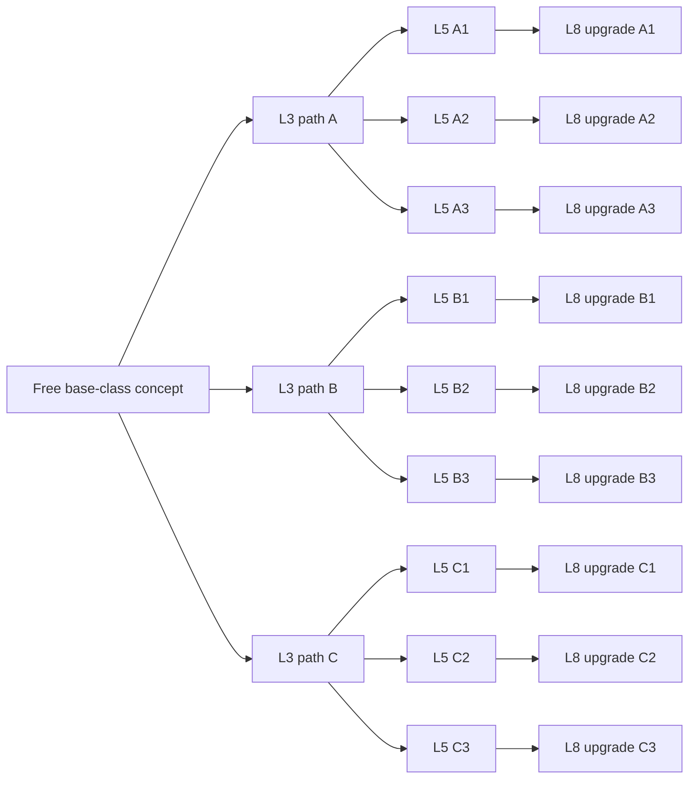

# DND expansion: rules, progression, generated classes and content tools

Update, 27 October 2026: [UI-THEMES-BALANCE.md](UI-THEMES-BALANCE.md) is the current specification for the redesigned Waypoint interface, three world themes, image terrain, aggregate class/skill power limits and DeepSeek cost calculator. Its shared budgets supplement the primitive schema ranges below. Difficulty formulas and the confirmed progression structure remain applicable.

## 1. Confirmed scope

The game remains a 2D, square-grid, turn-based RPG with a persistent story. DeepSeek creates the complete class sheet from a player's concept, including original classes unrelated to D&D. Accepted content is data that the local game executes and saves. Local code determines combat legality, dice, difficulty, progression, monster decisions and campaign facts.

The user confirmed both interpretations during this session:

- **Nine final class paths:** three level-3 choices, each with three level-5 specializations; level 8 upgrades the selected specialization.
- **26 skills learned:** two regular skills at each of ten levels, plus two unique skills at each of levels 3, 5 and 8.

“50 skills” means **five regular options per level × ten levels = 50 regular options per base class**, not 50 options at every level. A complete class content pack also includes 42 unique skill records across all branches; any one character learns six of those unique skills.

## 2. Current implementation and delivery boundary

| Area | Implemented in this change | Further expansion |
| --- | --- | --- |
| Difficulty | Easy/normal/hard selector, explicit count/level/stat formulas, configuration editor, previews, encounter snapshots | Optional staged reinforcements and encounter telemetry |
| Classes | Free concept API prompts, resumable generation, strict validation, publishing, custom stats, creation from published sheets | Additional effect primitives when a concept genuinely requires them |
| Progression | Level cap 10, choose 2 of 5 at level 1 and every later level, 3/5/8 class decisions, 2 unique grants at each milestone | Optional respec and active loadouts |
| Skill execution | Data-driven damage, healing, shielding, movement allowance and four conditions; costs, cooldowns, team filters, areas and sight | Summons, terrain construction, chained effects and reactions |
| Skill Canvas | Shared targeting geometry with combat; editable templates, aim controls, animation preview and JSON export | Sprite atlas/art customization and more effect styles |
| Monster/item/story templates | Strict schemas, examples, authoring editor, local library and export | Runtime publication of these individual library records into encounter rosters, equipment effects and the campaign state machine |
| Story prompts | Authored progression/authority rules and authoritative encounter context in DeepSeek requests | Full generic quest/chapter state machine beyond the current Blackstone campaign |

The content-template editor explicitly identifies library records as authoring data. Saving a new monster/item/story record there does not silently replace the current built-in campaign roster or equipment code. This document specifies that next integration as well as the working changes above.

## 3. Difficulty contract

### Party reference level

For the registered party of N heroes:

```text
averageLevel = sum(hero.level for every registered hero) / N
anchorLevel  = floor(averageLevel + 0.5)  // positive numbers: round half up
```

Include downed heroes. Do not let an injured party lower encounter difficulty by temporarily ignoring a member. Only change party membership outside combat. Save the exact unrounded average and the resulting encounter plan before rolling initiative. A character can never exceed player level 10.

| Setting | Regular monster level | Boss level | Combat stat multiplier |
| --- | --- | --- | --- |
| Easy | max(1, anchor − 1) | anchor | 0.90 |
| Normal | anchor | anchor | 1.00 |
| Hard | anchor | min(11, anchor + 1) | 1.20 |

The level-1 floor is intentional: easy enemies cannot be level 0. The hard boss is permitted to reach level 11 against a level-10 party. A boss also retains its boss template's stronger base values and authored abilities; it does not become a regular enemy merely because its level equals the party.

### Minimum enemy count

Configurable formula:

```text
minimumCount = max(profile.minimumMonsters,
                   ceil(N × profile.countPerHero) + profile.countOffset)
```

Defaults: countPerHero=1 for all difficulties; minimumMonsters=1/2/3 and countOffset=−1/0/+1 for easy/normal/hard.

| Party size | Easy | Normal | Hard |
| --- | --- | --- | --- |
| 1 | 1 | 2 | 3 |
| 2 | 1 | 2 | 3 |
| 3 | 2 | 3 | 4 |
| 4 | 3 | 4 | 5 |

These counts include the boss. A normal solo boss encounter has one boss plus at least one regular enemy. The configuration validator requires counts to increase strictly from easy to normal to hard for party sizes 1–4. The current map has twelve explicit legal enemy spawn positions; configurations above that capacity are rejected rather than truncated. All current encounters spawn their full roster at entry.

Future reinforcement mode must still meet the **total encounter** minimum. It should show the total enemy count, incoming wave and arrival turn before combat. Enemy waves must not spawn on occupied cells, appear behind the player without a warning, or add an unbounded number of turns.

### Level growth and stat scaling

Each template has an authored base level and base stats. First scale the template to the encounter's chosen level, then apply the difficulty multiplier exactly once to the stored combat values.

```text
delta          = encounterMonsterLevel − template.baseLevel
leveledHP      = baseHP × max(0.5, 1 + 0.18 × delta)
leveledAC      = max(6, baseAC + floor(delta / 3))
leveledAbility = baseAbility + floor(delta / 2)

finalMaxHP     = max(1, round(leveledHP × difficultyMultiplier))
finalAC        = max(6, round(leveledAC × difficultyMultiplier))
finalAbility   = max(1, round(leveledAbility × difficultyMultiplier))
damageScale    = max(0.5, 1 + 0.10 × delta) × difficultyMultiplier
finalDamage    = round(resolvedDamage × damageScale)
```

HP growth and damage growth are editable in the rules page. The six ability scores, HP, raw AC and damage use the difficulty rules. Movement speed, tile range, skill radius, resource pool, cooldown length, XP thresholds and number of actions do not receive a hidden percentage change. Derived attack bonuses and spell DCs are calculated from the resulting attributes and proficiency; do not multiply those derived values again. Template dice are not separately increased by the percentage when `damageScale` already applies it.

Example: party levels [3,4,5,4] have average=4 and anchor=4. A regular template with base level 1, HP 20, AC 12 and STR 12 becomes:

| Value | Easy | Normal | Hard |
| --- | --- | --- | --- |
| Regular/boss target levels | 3 / 4 | 4 / 4 | 4 / 5 |
| Minimum enemies | 3 | 4 | 5 |
| Regular HP | 24 | 31 | 37 |
| Regular AC | 11 | 13 | 16 |
| Regular STR | 12 | 13 | 16 |
| Regular damage scale | 1.08 | 1.30 | 1.56 |

The Workshop also offers optional `defenseScaling="bonus"`: `10 + (leveledAC−10) × multiplier`. It changes only the AC interpretation. The default remains the user's literal raw-AC multiplier. Show this distinction openly; it is especially relevant in a d20 system where a small AC increase changes hit probability substantially.

Difficulty changes apply to the next generated battle. They never heal or rescale monsters already in the current encounter. The campaign saves the rules and resolved encounter plan with its roster, so loading does not reroll stats.

### Failure cases and guards

- High-level carry characters can dominate an average-level encounter. Show the party's min/max levels and warn when the spread exceeds three levels; any future power-rating adjustment must be an explicit separate setting.
- Hard combines more enemies, stronger stats and a stronger boss. Do not assume that +20% stats means only 20% more encounter pressure.
- High AC can turn fights into repeated misses. Display sample hit chances before publishing custom profiles.
- Reject an empty party, invalid hero levels, impossible spawn counts and non-increasing difficulty counts.
- Do not quietly weaken hard mode because the player is losing. Offer a clearly labeled difficulty change for the next encounter.

## 4. Player stats and free class identity

Core abilities remain STR, DEX, CON, INT, WIS and CHA for compatibility with the board and checks. A generated class may assign its own core scores and add up to eight named custom attributes, such as Precision, Rhythm, Pressure or Attunement. A custom attribute has a stable ID, display label, starting value and growth per level. It can drive skill scaling and be the class's primary attack/casting stat.

The class sheet specifies HP, armor, speed, basic attack, attack range, primary stat, resource name/max/regeneration, stat growth, ten level pools and the advanced tree. Character creation shows these values; the player may customize identity, colors, core scores and custom starting attributes within the configured content limits. Free class identity does not require executing new code generated by a model.

Current primitive limits: core starting stats 6–20; custom starting stats 1–20; primary stat must exist; HP 16–50; AC 10–18; speed 3–8 tiles. These are visible authoring rules, not D&D edition restrictions. Expanding the limits should be a versioned rules change with a new balance check.

```text
abilityModifier = floor((abilityValue − 10) / 2)
proficiency     = 2 + floor((level−1)/4)
attackBonus     = primaryAbilityModifier + proficiency
spellSaveDC     = 8 + primaryAbilityModifier + proficiency
```

Player-written identity and concept are stored in the campaign. A later narrator response cannot rename the hero, replace their class, or rewrite their backstory.

## 5. Level 1–10 skill progression

| Level | New regular options | Regular skills learned | Class event | Unique grants | Total learned after choices |
| --- | --- | --- | --- | --- | --- |
| 1 | 5 | choose 2 | Base class | 0 | 2 |
| 2 | 5 | choose 2 | — | 0 | 4 |
| 3 | 5 | choose 2 | choose 1 of 3 advanced classes | 2 | 8 |
| 4 | 5 | choose 2 | — | 0 | 10 |
| 5 | 5 | choose 2 | choose 1 of selected class's 3 specializations | 2 | 14 |
| 6 | 5 | choose 2 | — | 0 | 16 |
| 7 | 5 | choose 2 | — | 0 | 18 |
| 8 | 5 | choose 2 | upgrade the selected specialization | 2 | 22 |
| 9 | 5 | choose 2 | — | 0 | 24 |
| 10 | 5 | choose 2 | level cap | 0 | 26 |

No choices are automatically substituted. The three unchosen regular skills remain in the class catalog; they are not granted on a later level. Re-selecting the same pool, duplicate picks, off-branch classes, wrong-level skills and advancement past level 10 are rejected. XP can be recorded at cap, but it creates no level-11 player.

XP threshold for reaching level L in the current implementation:

```text
threshold(L) = 50 × (L−1) × (L+2)
L1: 0; L2: 200; L3: 500; L5: 1400; L8: 3500; L10: 5400
```

An encounter awards `floor(totalMonsterXP / registeredPartySize)` per hero, with a minimum of one. Each encounter has a persisted reward flag so one fight cannot pay twice. Large XP gains can queue several level choices. Resolve them in chronological order at a safe moment before the next encounter. At a given milestone, choose regular skills first, then its advanced class.

The proposed default advanced bonuses are +10% at level 3, +10% at level 5 and +15% at level 8 to the selected node's specialist attribute. The percentages are stored per node and editable. Bonuses apply once, when that node is selected. A CON specialization changes the CON attribute immediately; existing maximum HP is not retroactively rebuilt. Future level-up HP uses the new CON modifier. A future retroactive-HP option needs its own explicit formula.

## 6. Advanced class tree



There are nine final paths, 21 advanced nodes and 42 unique skill definitions. A player selects three nodes along one path, receiving two unique skills at each node. The base class is an additional identity, not counted as a tenth final path. Level 8 has one eligible upgrade of the selected level-5 specialization; it does not open unrelated branches.

The included Clockwork Warden is an explicitly labeled offline example with all 50+42 records. User-created sheets are authored through DeepSeek, then validated and published. The example demonstrates the format and does not pretend to be a live model response.

## 7. Turn and monster behavior model

Each living combatant owns an initiative turn. Recommended default: movement up to speed plus one action, with movement possible before or after the action. Monster templates may select:

- `move-and-act`: move up to speed and take one legal action.
- `move-or-act`: moving consumes the turn's action; an adjacent monster may choose to act instead.
- `stationary`: no movement, one legal action.

Cooldowns tick on the owning actor's turn, not every global turn. A cooldown of one blocks the actor's next turn; uses and resource costs are independent checks. Resources regenerate by the class sheet's per-turn amount, capped at its maximum. Conditions use affected-actor turns: burn damages at turn start; root blocks movement; slow halves movement; weaken reduces outgoing damage. No condition lasts more than three affected turns in the current primitive set. Shields absorb incoming damage and are capped at half maximum HP.

Ordered monster rules are local content. Examples: if a target has >80% HP, use a ready opening skill; when own HP first reaches ≤70%, use a ready panic skill; attack an in-range opponent; otherwise approach. Store separate once-per-encounter trigger flags and cooldown/use state. Evaluate legality before consuming a trigger. A failed skill target must fall back to another legal action rather than consuming the entire rule chain.

For the generic monster-template integration, use a strict one-movement/one-action budget shared by every rule so several matching conditions cannot create extra actions. Log the chosen rule ID and target. A boss can have phases and stronger skills, but any additional action budget must be declared in its template and the encounter preview.

## 8. Skill data and the 2D Canvas template

Source schema: `shared/schema.mjs`; exported schemas: `design/contracts/*.schema.json`; examples: `public/templates/skill*.json`.

A skill declares ID, name, description, unlock level, resolution, save stat, half-on-save policy, area shape, range, radius/length/width/angle, radius metric, target team, friendly fire, sight requirement, target cap, effects, uses, cooldown, resource cost and visual style.

Supported effects:

| Operation | Required information | Result |
| --- | --- | --- |
| damage | dice, scaling stat, coefficient | resolved HP loss after shield |
| heal | dice, scaling stat, coefficient | HP recovery capped at max HP |
| shield | dice, scaling stat, coefficient | temporary absorption capped at half max HP |
| move | movement tiles | a bounded movement allowance; still respects walls/root |
| condition | burn/root/slow/weaken, duration | an explicit condition state |

Resolution can be attack, saving throw or automatic. A single cast resolves its chosen rule once per affected target; costs are paid once per cast, even on a miss. For save skills, damage can be halved on success; successful saves prevent conditions. The engine never evaluates an arbitrary formula or generated script.

Geometry uses integer `{x,y}` tiles; one tile is 5 ft. Cast range uses Chebyshev distance, consistent with the board's 5-ft diagonal movement. Radius can use Euclidean, Chebyshev or Manhattan distance and the selected metric is visible in the editor.

| Shape | Anchor | Parameters |
| --- | --- | --- |
| single | aimed tile | range |
| self | caster tile | ignores aimed position |
| circle | aimed tile | radius and metric |
| ring | aimed tile | outer radius and inner exclusion from width |
| cross | aimed tile | radius and arm width |
| line | caster, directed toward aim | length and width |
| cone | caster, directed toward aim | length and angle |

For line/cone skills, the aimed tile selects a direction; effect length is measured from the caster. A circle's area may extend beyond the center's cast range. Walls are excluded and sight checks clip affected tiles according to the declared sight rule. Target allegiance, friendly fire and maxTargets determine actual actors after geometry. The preview shows affected cells, not a promise of a successful hit.

`shared/canvas.mjs` is the reusable Canvas 2D renderer. `renderSkillCanvas` draws the board, blockers, range, caster, aim and selected tiles; `animateSkillCanvas` draws a short visual effect and returns a cancellation function. It has no authority to change HP or positions. The game's Phaser overlay uses `affectedTiles` from the same shared module, so separate renderer code cannot invent a different radius. Visual styles are bolt, burst, sweep and pulse, with a color and bounded duration. Animation runs only while needed.

## 9. Item, monster and story templates

### Items

The item schema includes slot, rarity, level, value, stack limit, flat/percentage modifiers, granted skill IDs and consumed-on-use. Runtime integration must compute equipped values from base stats and the current item set; never permanently add and later attempt to subtract arbitrary bonuses. Validate item quantities, unique ownership, slot conflicts and skill references. On unequip, remove only item-granted skills, preserving skills learned from the class. Do not multiply an item's damage bonus a second time in a percent-stat layer.

### Monsters

A monster schema includes role, base level, HP/AC/speed, core stats, attack dice, movement/action profile, skill references and priority-ordered behaviors. Encounter construction chooses from eligible templates and applies the frozen difficulty plan. The full runtime integration should validate skill IDs against the published registry, add a faction/team ID, permit tagged encounter rosters, and reject templates that have no legal fallback action.

### Story beats

A story beat declares chapter, type, required facts, objective ID, choices, resolved event IDs, encounter tag and reward table ID. Suggested state machine:

```text
offered → active → complication/combat/choice → resolved → rewarded → next eligible beat
```

Only engine events update those states. Conversation describes possible choices; it does not apply their results. Store a compact campaign bible, known clues, NPC goals, faction relations and unresolved hooks. A failed check can cost time, make noise, reveal an alternate route or change a relationship, while leaving at least one legal continuation. Persist the random seed and selected beat/content IDs.

## 10. DeepSeek prompt and generation protocol

The active prompt pack is `server/prompts.mjs`; generation validation/merging is `shared/generation.mjs`. Prompts define an authority order, progression rules, action limits, exact difficulty formulas, content contracts and typed output modes.

| Mode | Input | Accepted output |
| --- | --- | --- |
| scene | canonical scene, progression facts, encounter plan | short sensory detail with unchanged title/objective |
| intent | player command, active actor, known targets and learned skills | safe proposed action, target/skill IDs or clarification |
| narrate | already resolved events | short prose preserving results |
| class_sheet | free class concept and schema | class stats/resource/growth plus 21-node tree; no skill bodies yet |
| level_skills | accepted class identity, requested level | exactly five distinct regular skill records |
| advanced_skills | up to three approved advanced nodes | exactly two unique skills per requested node |

Generation is resumable: one sheet + ten regular pools + seven batches of three advanced nodes = **18 requests** for a full pack. Generate a single next segment when preferred. A failed response does not erase accepted segments. Save each accepted segment locally, show remaining requests, let the user stop after the current segment, and validate the full pack before publishing. The model authors the sheet and content; code only validates and executes the definitions.

Full validation checks schema/field limits, IDs, custom-stat references, exactly five options per regular level, ten unique levels, the 3/9/9 parent topology, two unique skills per node, duplicate skill IDs, effect budgets and supported operations. Publishing copies the approved sheet into new heroes. Existing heroes keep their saved sheet rather than being silently rewritten by later edits.

Do not generate the same class on each combat turn. Store a draft, approved sheet and model provenance separately. A later content version can be imported as an explicit migration. For future just-in-time generation, retain the complete branch outline but generate only the next relevant level and selected branch pair; mark missing sections openly and never start a required choice without its validated pool. The current Workshop offers both single-segment and full-pack generation, with full-pack validation required for publishing.

API requests use JSON output and bounded responses. Reject empty content, truncated output and invalid JSON; return a segment-specific error. Keep the key on the local service. Track accepted calls, input/output tokens and cache-hit tokens; attach money estimates only when configured with verified model prices. Avoid automatic paid retry loops. Keep stable system/schema instructions before changing player/context data so cacheable prefixes can remain stable.

## 11. Configuration pages

The working `/workshop.html` includes:

1. **Difficulty & rules:** all three profiles, level offsets, percentage buffs, minimum counts, party-size counts, HP/damage level growth, AC scaling interpretation, default mode, JSON editor and live mixed-level party preview.
2. **Classes & progression:** concept field, staged DeepSeek authoring, request/token counters, complete JSON import/edit/export, saved drafts, tree/path preview, level pools, validation and publishing.
3. **Skill Canvas:** shape/range/radius/length/width/angle/metric, friendly fire and sight controls, mouse and keyboard aim, animation preview, skill JSON validation, export and applying a changed skill to its class draft.
4. **Items, monsters & story:** typed templates, JSON editing, validation, local authoring library and export. Runtime publication of these library types remains a separate step, with the constraints in section 9.

The game page includes the next-battle difficulty selector, a Workshop link, a Progression page, a creator that reads published classes, current encounter difficulty/count/average, generated skill controls and persistent character stats/resources. Pending advancement choices prevent entering the next fight. Difficulty or content edits do not mutate a battle already in progress.

## 12. Additional features worth adding

| Priority | Feature | Practical purpose | Guard/acceptance |
| --- | --- | --- | --- |
| First | Enemy intent and boss telegraphs | Show intended target and area before a large attack | Preview uses the same legal action as execution; plans revalidate if a target dies |
| First | Previewable encounter manifest | Explain the selected difficulty before entry | Exact total count, levels, stat policy and boss role match spawned actors |
| First | Reinforcement waves | Preserve larger encounter totals without excessive simultaneous turns | Fixed total budget, visible arrival schedule and legal spawn checks |
| First | Skill comparison and six-skill active loadout | Keep 26 learned skills usable during combat | Learning count remains 26; only loadout changes at safe moments |
| First | Content compatibility report | Tell the player when a novel class concept needs a new effect primitive | Unsupported behavior stays a draft, never pretends to work |
| Next | Checkpoint and full campaign JSON export | Recover a party after browser storage loss or a bad decision | Import validates schema, content references, RNG and encounter state |
| Next | Non-kill objectives | Escort, hold ground, interrupt a ritual, escape or negotiate | Explicit victory/failure event predicates and reward rules |
| Next | Reputation and faction clocks | Give story choices consequences beyond loot | Values change from resolved events with visible journal records |
| Next | Resource-aware rest pacing | Make healing, cooldown recovery and story time meaningful | Rest eligibility and consequences are explicit; no infinite free rest |
| Later | Content authoring suggestions for NPC/item packs | Expand the world once and reuse approved content | Review/validate/publish; cache by stable ID and content version |
| Later | Battle replay and action explanation | Explain why a monster acted and reproduce bugs | Save RNG state, content snapshot and ordered resolved events |

The first three recommendations complement the requested hard-mode population increase. Jev selected declarative validated content and telegraphs/waves over the presented alternatives, each at 100% probability in its returned choice distribution. This is Jev's confidence in those judgments, not an outcome probability or proof of balance. The exact questions are saved in `design/jev-design-questions.json`.

## 13. Auto-research experiment

The isolated `research/difficulty-lab` follows the invoked auto-research skill: one mutable target, an evaluator frozen before the baseline, a written objective, fixed seeds, baseline/candidate results, a ledger and local commits. Only the AC scaling interpretation changed. The evaluator and the shared formulas were hashed before the baseline.

Two candidates each ran **8,640 abstract matches**. Baseline raw AC scored −10.090953; optional defense-above-10 scored −9.823881 against the frozen objective, so the lab retained that candidate. Neither candidate had a monotonicity violation. The evaluator's mean hard win rates were approximately 2.81% and 6.94% respectively. These are outcomes in an attack-only approximation, not observed player win rates. Movement, healing, area skills, resources, custom class combinations and terrain are omitted.

The evidence suggests that simply stacking enemy count and percentage buffs can make hard encounters very severe in this model. It supports showing the arithmetic and testing full encounters; it does not justify silently changing the user's requested values. The game still defaults to raw AC, with the alternate interpretation available in the configuration page. Preserve the exact benchmark and report its limits before extrapolating.

## 14. Implementation sequence for the remaining systems

1. Publish individual monster/item/story library records into versioned content packs; resolve every referenced skill/faction/quest ID before loading a campaign.
2. Replace the fixed Blackstone chapter transitions with the story-beat state machine and registered event predicates. Keep the current story as a first content pack.
3. Add encounter manifests and telegraphed waves while preserving the same total difficulty budget and average-party reference.
4. Add intent previews and a compact active skill loadout, then teach their use in the first tutorial fight.
5. Expand the effect registry only when a real class concept requires it. Add semantics, templates, validation, targeting preview, replay fields and a meaningful execution check together.
6. Evaluate the complete game across party sizes, mixed levels, class branches, AoE/control combinations and all difficulties. Include solo parties and level-10/hard-boss level-11 cases. Tune defaults only with explicit evidence and version the change.

## 15. Primary research sources

- [DeepSeek JSON Output](https://api-docs.deepseek.com/guides/json_mode/) — JSON mode configuration, explicit JSON instructions, response sizing and empty-content handling informed the staged/validated generation protocol.
- [DeepSeek Context Caching](https://api-docs.deepseek.com/guides/kv_cache/) — prefix matching and cache-use counters informed stable prompt ordering and token telemetry; cache hits are best effort.
- [D&D 2024 Free Rules: Playing the Game](https://www.dndbeyond.com/sources/dnd/br-2024/playing-the-game) — movement, actions and initiative provide the starting vocabulary. Custom classes and difficulty formulas here are homebrew rules.
- [MDN Canvas basic animation](https://developer.mozilla.org/en-US/docs/Web/API/Canvas_API/Tutorial/Basic_animations) and [Canvas optimization](https://developer.mozilla.org/en-US/docs/Web/API/Canvas_API/Tutorial/Optimizing_canvas) — frame scheduling and reusable drawing informed the Canvas template.

Research checked 26 October 2026. Existing code, exported schemas, completed checks and browser behavior remain the evidence for implementation claims; external references do not prove this game's correctness.
